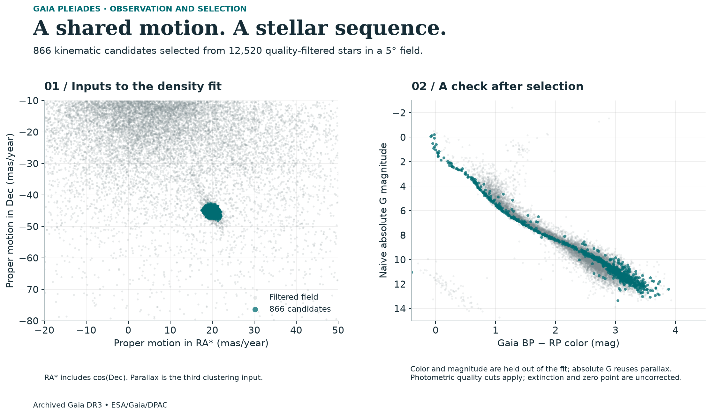

# Gaia Pleiades Member Finder

Which stars are likely to belong to the Pleiades cluster, rather than just appearing nearby in the sky?

## What Gaia measures

The Pleiades is a group of stars that formed together. Unrelated stars can appear in the same direction, so a telescope image alone cannot tell us which stars belong to the group.

Gaia measured the positions of stars over time. Small yearly shifts in their apparent positions provide distance information, while longer-term changes show their movement across the sky. Stars belonging to the same cluster often have similar distances and motions.

## Why identifying the stars matters

Stars in a cluster formed at roughly the same time. Identifying its members lets astronomers compare stars of different masses at a similar age and test explanations of how stars change over time.

Including unrelated stars, or excluding genuine members, can distort the cluster's pattern of color and brightness. The candidate list therefore affects the physical conclusions a later study could draw from the group.

## What this project actually does

This version uses real Gaia DR3 measurements for 12,520 stars in a filtered field around the Pleiades. A clustering method groups stars by distance and motion. The known approximate distance and motion of the Pleiades identify which group to examine.

The chosen selection rule returns 866 candidate stars. Their color and brightness also form a recognizable stellar pattern, providing an additional check on the selection. The project compares the list with a published catalog and examines how changing the rules changes which stars are included.

Stricter rules produce smaller lists, and two lists of similar size can contain different stars. Those choices need to be visible before the list is used to study the cluster.

The outcome is an inspectable candidate list with the measurements and selection rules behind it. It does not confirm every star's membership, discover a new cluster, or produce a complete list of all Pleiades stars.



[Read the case study](https://alisonthomasportfolio.com/projects/pleiades) · [Explore the code](https://github.com/alithomas321/pleiades-member-finder/tree/main/src/gaia_pleiades) · [Methods](METHODOLOGY.md)

<details>
<summary>Run the code</summary>

With Python 3.12 and [uv](https://docs.astral.sh/uv/):

```sh
uv sync --frozen --extra dev
uv run pytest
uv run gaia-pleiades run --project-root .
uv run gaia-pleiades verify --project-root .
```

The archived Gaia DR3 field and reference catalog are included, so the analysis can run offline after setup. Data come from ESA Gaia and the Hunt-Reffert catalog via CDS VizieR; [the data manifest](data/dataset_manifest.json) records the sources and checksums. Additional selection checks and figure code are in [case-study-analysis](https://github.com/alithomas321/pleiades-member-finder/tree/main/case-study-analysis).

</details>

Background: [ESA: using shared stellar motion to identify stars that formed together](https://www.esa.int/Science_Exploration/Space_Science/Gaia/Gaia_untangles_the_starry_strings_of_the_Milky_Way). Data: ESA/Gaia/DPAC, Gaia DR3; comparison catalog: Hunt & Reffert (2024).
