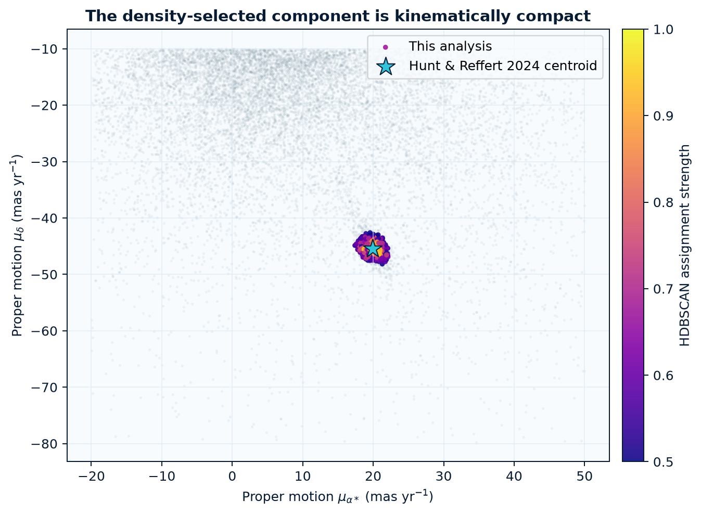
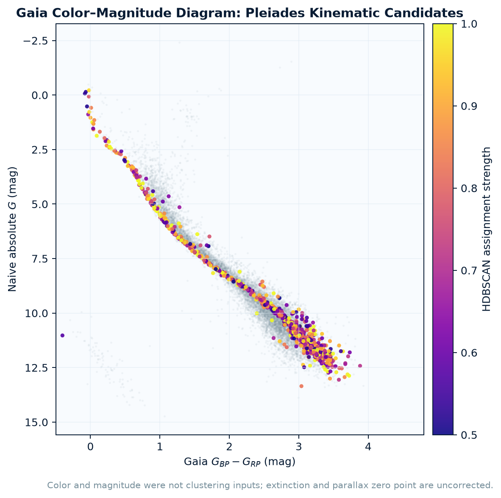
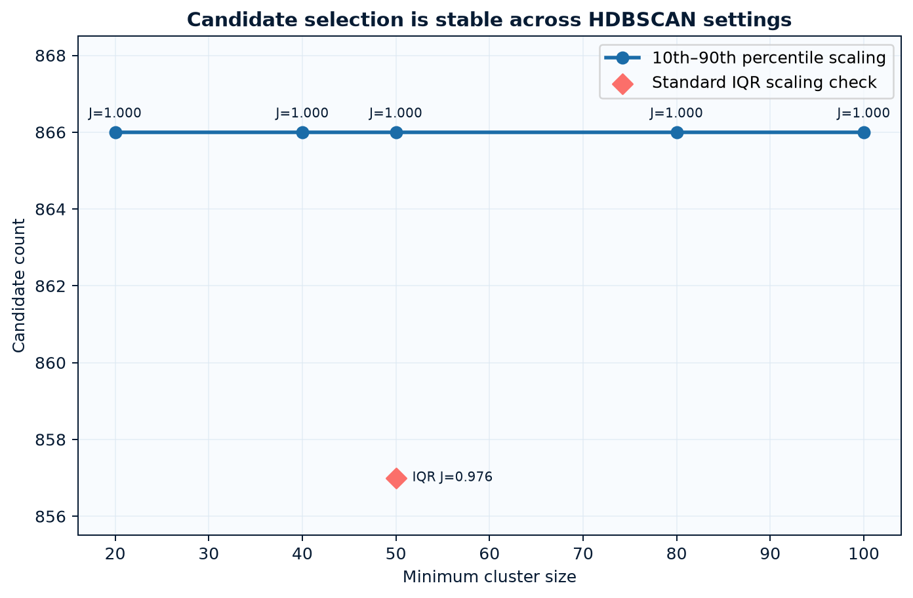

# Results

## Headline result

The pipeline selected **866 Pleiades kinematic candidate members** from
12,520 quality-filtered Gaia DR3 sources in a
five-degree field. The model used only parallax and two-component proper motion.

| Measurement | This analysis | External comparison |
|---|---:|---:|
| Median parallax | 7.3681 mas | 7.3783 mas (Hunt & Reffert 2024) |
| Median pmRA* | 19.9474 mas/yr | 19.9552 mas/yr |
| Median pmDec | -45.3983 mas/yr | -45.4567 mas/yr |
| Descriptive inverse-parallax distance | 135.72 pc | 136.2 ± 1.2 pc (VLBI) |

## Catalog agreement

- 781 of 866 candidates occur in the
  current high-confidence, within-tidal-radius Hunt–Reffert list
  (**90.18% candidate agreement**).
- The pipeline recovers 781 of
  872 comparable catalog sources that pass
  this project's query (**89.56% conditional recovery**).
- Against all 1,014 high-confidence catalog sources,
  including objects excluded by this query, recovery is
  **77.02%**.

These are catalog-agreement measurements, not accuracy against ground truth. Both studies use
Gaia DR3 astrometry and density-based clustering.

## Stability

Across the tested `min_cluster_size` values, candidate counts range from
866 to 866; Jaccard overlap
with the main result ranges from 1.000 to
1.000. Switching to standard IQR scaling gives a Jaccard overlap of
0.976.

## Important limits

- These are kinematic candidates, not confirmed or necessarily gravitationally bound members.
- `cluster_strength` is HDBSCAN assignment strength, not a calibrated membership probability.
- The quality cuts reduce contamination but bias the sample against faint sources and binaries.
- The five-degree cone approximates the tidal region and does not cover the full stellar tails.
- Gaia's position-, color-, and magnitude-dependent parallax zero point was not corrected.
- The inverse-parallax distance is a descriptive summary, not a Bayesian distance estimate.
- Photometry and the comparison catalog were withheld from clustering and used afterward only.

## Figures

